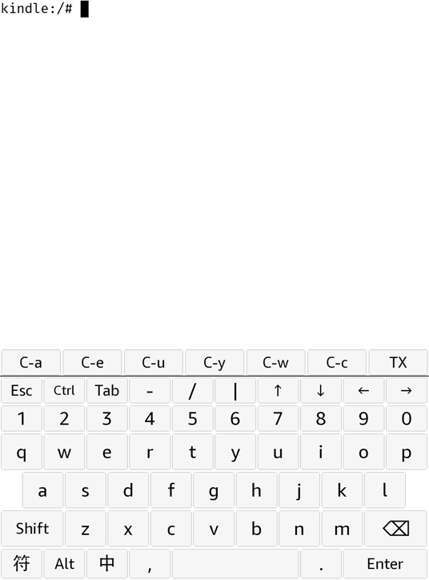

# kterm for Kindle

越狱 Kindle 上的终端，触屏好用。基于 [kterm](https://github.com/bfabiszewski/kterm)，在 Kindle Paperwhite 4 上日常使用。

<p>


</p>

## 能做什么

- **适合敲命令的键盘**：Esc、Ctrl、Tab、方向键和数字都在第一屏。Shift 出大写和 `!@#`，“符”键出 F1–F12 和各种符号。字母行比其他行高，键之间留了空隙，不容易按错。横屏时键盘分成左右两半，中间留空，两边各有一个空格键，两只手各按一半。点过的键变黑并保持 0.4 秒，打字快时也看得出前几下都按到了；按下的 Shift、Ctrl、Alt、“符”会一直黑着，用完自动恢复。
- **中文输入**：点“中”调出 Kindle 自带的拼音键盘。
- **语音输入**：设置 → 语音输入 打开后（默认关），键盘上多一个“语音”键，点它显示二维码和网址。手机扫码打开网页（可以加到书签或主屏幕），在网页的输入框里用手机输入法的麦克风说话（微信输入法、iPhone 听写都行），也可以打字、改错：
  - “发送”：文字放进快捷栏上方的一个小框里，不碰终端（太长时中间省略）。框里的按钮和网页的一样，只有图标：最左边 ▶ 放入并执行（发送并回车），右边纸飞机放入终端的输入框、不执行（发送），✕ 丢掉文字、关掉框（清空）。放入前都会先退出往上翻的状态。键盘上的回车也能放入。点框外面不会关掉它。没放入前再发的接在后面。
  - “发送并回车”“回车”：终端停在输入行时直接放入并执行；正往上翻着看（kterm 自己的历史，或 tmux 的复制模式）时不打断，先放进框里（▶ 按钮变黑），点一下就退出往上翻、放入并执行。
  - 网页下面是最近发送的 50 条（只存在这台手机的浏览器里）：点一条填回输入框，连点几条一行一条接起来；每条右边可以直接发送、发送并回车、复制。键盘弹出时输入框和按钮总在键盘上方，列表可以往下滚着看。
  - tmux 是不是在往上翻，是收到文字时通过同一个 ssh 连接问 tmux 的（见下面的 tmux 集成）；问不到时文字先放进框里。没有 tmux 也照常用：看的是 kterm 自己的历史。
  - 网址里带着口令（`kterm.conf` 里的 `voice_token`），没有口令的设备连不进来；面板里“换口令”后旧网址作废。手机和 Kindle 要在同一个 Wi-Fi；路由器给 Kindle 换了 IP 就再扫一次。网页是 HTTP，同一网络里能抓包的人看得到发送的文字。
- **tmux 集成**（设置里，默认开）：kterm 通过 ssh 连接问远端的 tmux，用在三处：
  - 连上 ssh 后（从面板连，或自己输入 `ssh`）如果远端 tmux 有会话、登录时又没自动进 tmux，面板弹出会话列表（最近用过的在前，显示窗口数、多久前用过、别处是否正连着）：点一个就进去（`tmux attach`），也可以“新建会话”或“不用 tmux”。每次连接只问一次。
  - 手机发来“发送并回车”时，判断 tmux 是不是在往上翻；点框里的按钮时先让 tmux 退出往上翻。
  - 预览时左右滑动切 tmux 窗口。
  - 从面板连接时，这个 ssh 连接本身就是共享的主连接（`ControlMaster`，`/tmp/kterm-ssh-*`，断开后留 10 分钟），kterm 的提问都走它，密码登录也行，约 0.1 秒。自己输入的 `ssh` 由 kterm 另开连接去问，需要密钥登录。不用改远端的 `~/.tmux.conf`。
  - 关掉后 kterm 不在远端运行任何命令，只看自己的历史；左右滑动不切窗口，连上也不弹列表。
- **快捷栏**：键盘上方一排按钮，点一下发一串按键，比如 `C-a`、`C-u`、tmux 前缀。可以在面板里添加、修改、删除；按钮宽度按屏幕算：放得下就全放一行、平分宽度，放不下才左右滑动翻页。两头各有一个小按钮：
  - 左边 **☰**：打开面板。
  - 右边 **键盘**：带向下箭头的是收起键盘，进入**预览**：终端占满屏幕专心看输出，上下滑动翻屏，在 tmux 里左右滑动切窗口；快捷栏留在底部，C-c、tmux 前缀照样能按。不带箭头的是把键盘放回来。在键盘上往下滑也能收起。
  - **前缀**：快捷键可以标成前缀（设置 → 快捷键里打开，或在 shortcuts.conf 里那一行末尾写 `+键盘`）。预览时点它，发完前缀键盘就弹出来，再按一个键（比如 tmux 的 `c`、`[`）键盘自动收回，接着预览。Shift、Ctrl 这些不算那一个键。前缀按钮右下角有一个深色小三角。
- **面板**：从顶部出现，点键盘或终端就收起。从屏幕顶部往下滑仍是 Kindle 自己的快捷设置（亮度、深色模式）。
  - **连接**：保存 SSH 服务器，点一下就连上；正在连着别的也能直接切过去。点“查找”列出局域网里能 ssh 的机器（Mac 要在 系统设置 → 通用 → 共享 里打开“远程登录”），点一台、填上用户名就存好了：存的是它在局域网里的名字（如 `vidy-macbookpro.local`），路由器换了 IP 也照样连得上。
    - **密钥**：表单里选登录用的密钥（`~/.ssh` 里带 `.pub` 的），选了就不用输密码；“不用”是每次输密码。Kindle 上只有一个密钥时，新建和“查找”添加的连接自动选上它。一个都没有时点“生成密钥”（`id_ed25519_kindle`）。
    - **装到电脑**：第一次连一台电脑时点它，终端里会问一次那台电脑的密码，把公钥加进它的 `~/.ssh/authorized_keys`（已有就不重复加），以后直接用密钥登录。
  - **断开**：连着 SSH 时才出现，只断开 Kindle 这一端；远端 tmux 里的程序照常运行。
  - **设置**：字号、屏幕方向（竖屏 / 横屏）、刷新（省电 / 标准 / 流畅）、全刷（关 / 少 / 多）、快捷键（管理快捷栏），都会记住。
- **省电**：程序自己在动的时候（Claude Code 的转圈和计时、进度条、tmux 状态栏），屏幕最多每秒刷新 2 次（设置里可改成 1 次或不限）；点屏幕、打字后 3 秒内照常立刻刷新。5 分钟不碰就停住不刷，一碰马上更新（`kterm.conf` 里 `idle_pause = 分钟数`，0 是不停）。光标不闪烁，每闪一下都是一次墨水屏刷新。
- **清残影**：墨水屏平时只刷变了的地方，滚动、切 tmux 窗口、翻页后会留下前一屏的残影，只有全刷（闪一下黑白）能清掉。像 Kindle 看书翻页一样，kterm 让翻页那一下直接以全刷显示：点击翻页、上下滑动滚动、左右滑动切 tmux 窗口时，先让系统等终端画完新内容，再一次全刷出来，事后不会再闪。设置 → 全刷：多是每次都这样；少是看改动量——上次全刷以来终端被打字、程序输出这些改动整个改写过一遍，这次翻页才全刷，否则照常；翻页、滑动本身不算（连续翻页不闪，Claude 输出了一屏以上再翻页才闪，刚打了几个字翻页不闪）；关是不刷。打字、程序自己的输出、停下来看的时候都不会闪。
  - **退出**
- **滚动**：在终端上拖动，内容跟着手指走，按住的那一行停在抬手的位置。
- **点击翻页**：点终端的上三分之一往回翻一页，下三分之一往后翻一页（留两行接着读）；键盘不算在内，预览和打字时都能用。中间三分之一和最后一行的点击照常交给程序，比如点 tmux 状态栏切窗口。
- **复制粘贴**：长按约半秒再拖动，选中文字，抬手就复制；快捷栏 ☰ 右边出现黑色的粘贴图标（剪贴板），点一下贴进终端，可以反复贴；再复制就换成新的内容。粘贴图标只在程序等着输入时出现（shell 提示符、Claude Code 的输入框，它们会打开括号粘贴模式），命令运行时就收起。tmux 自己一直开着这个模式，要让它通过标题转告当前窗格的状态，在 `~/.tmux.conf` 里加（只对 `kindle` 会话打开 `set-titles`，其他客户端用 tmux 默认标题；状态栏刷新时更新，可能晚几秒）：

  ```
  set -g set-titles-string '#{?#{==:#{client_termname},xterm-256color},kterm-paste:#{bracket_paste_flag},#S:#I:#W - "#T" #{session_alerts}}'
  set-hook -g session-created[50] 'if -F "#{==:#{hook_session_name},kindle}" "set -t kindle set-titles on"'
  ```
Kindle 本机、ssh 里的 tmux、Claude Code 里都能用。
- **看图**：终端里出现图片路径（以 .png、.jpg、.gif、.webp、.bmp 结尾，比如 Claude Code 的 `Read(~/Desktop/a.png)`），点一下路径，图片盖满屏幕；再点一下关掉。ssh 连着时图片从那台电脑上取（走同一个 ssh 连接；自己输入的 ssh 要用密钥登录，从面板连接的密码登录也行），否则读 Kindle 上的文件。不以 `/`、`~` 开头的路径，按 tmux 当前窗格的目录找，没有 tmux 时按终端里程序所在的目录（ssh 连着时是那台电脑的家目录）。路径里有空格的认不全；超过 15MB 的图不取；Claude Code 里粘贴的截图（`[Image #1]`）没有文件，打不开。
- **文字加深**（设置里，默认开）：墨水屏只有灰度，彩色字（Claude Code 的代码、提交号）和暗淡的提示字会变成浅灰、看不清。打开后所有文字一律画成深灰到黑（深色背景上是浅灰到白），背景色不变。
- **双指点击**：相当于鼠标右键。在 tmux 里会弹出它的菜单，点菜单项执行，点别处关闭。
- **一键安装**：KPM 安装包，装完图书馆里多一个“终端”。

## 安装

需要：已越狱的 Kindle，装好 [KPM](https://hackerdude.tech) 和 Alpine 镜像（`/mnt/us/alpine`）。

1. 从 [Releases](../../releases) 下载 `kterm-vte_<版本>_kindlehf.kpkg`，拷到 Kindle 根目录。
2. 在 Kindle 上执行：`kpm -y install file:///mnt/us/kterm-vte_<版本>_kindlehf.kpkg`
   第一次会在 Alpine 里装 GTK+ 3 和 VTE（约 60 MB），需要联网。
3. 在图书馆里打开“终端”。

---

## 技术说明

### 和原版的区别

- 在 Kindle 的 X 服务器上跑 GTK+ 3（来自 Alpine 的软件包，程序在 Alpine chroot 里运行）和自己编译的 VTE 0.84（[kindle/build-vte.sh](kindle/build-vte.sh)）：Alpine 的版本和补丁，加上 [kindle/vte/](kindle/vte/) 里的三个补丁——只重画写到的行（原版的改动范围初始值上下颠倒，打一个字也整屏重画，墨水屏上就是整屏刷新）、让 kterm 能问到程序是否在等输入（括号粘贴模式），以及文字加深（文字按背景画成深灰或浅灰）。装在 Alpine 的 `/usr/local/lib/kterm/`，只有 kterm 用它。
- 语音输入（[voice.c](voice.c)、[voicebar.c](voicebar.c)，网页在 [kindle/web/](kindle/web/)）：网页用 Tailwind 写，`sh kindle/build-web.sh` 编译（下载 Tailwind 独立可执行文件，不用 Node）成只含用到的样式，连同页面生成 `voice-page.h`，提交在仓库里，平时构建不需要 Tailwind。图标来自 Lucide（ISC）。打开时 kterm 自己在 7788 端口提供网页（GLib 的 GThreadedSocketService，没人连时只是一个等待的端口），关掉就不监听；启动脚本给 Wi-Fi 放行这个端口。要不要先放进框里：没有 tmux 看 VTE 的滚动位置；有 tmux 时像 rootshell 那样在同一个 ssh 连接上另开通道执行一段脚本（`ControlMaster`，[remote.c](remote.c)，看图取文件也走它），用 `tmux list-clients` 和 `who` 找到这台 Kindle 登录的 tmux 客户端，读 `#{pane_in_mode}`，放入时用 `send-keys -X cancel` 退出复制模式。二维码用 Nayuki 的 [qrcodegen](qrcodegen.c)（MIT）生成。
- 局域网发现（[kterm-mdns.c](kterm-mdns.c)）：多播 DNS / DNS-SD（苹果的 Bonjour），不常驻后台，要用时才问一次。`kterm-mdns browse _ssh._tcp` 列出能 ssh 的机器，`resolve` 查名字的地址，`connect` 给 ssh 的 `ProxyCommand` 用：先连上次找到的地址（缓存在 `/tmp/kterm-mdns/`），连不上再问，所以命令行里的 ssh、scp、git 也一样。地址是 `.local` 的连接保存时自动加上 `ProxyCommand /usr/local/bin/kterm-mdns connect %h %p`，自己写的 ProxyCommand 不动。Kindle 的防火墙挡掉回答，启动脚本给 Wi-Fi 放行来自 5353 端口的 UDP。
- 全刷（[flash.c](flash.c)）：Kindle 的窗口管理器（awesome + lab126 脚本）不会主动给 kterm 全刷。翻页、滑动前，kterm 给它发 `lab126_create_trigger` 消息：暂停刷屏，等终端区域整块重画完（最多 0.8 秒）再用 GC 波形全刷，和系统阅读器翻页同一个机制。
- 窗口用 X 服务器的 8 位 TrueColor 格式，和屏幕同深度，不用转换。32 位窗口每次刷新都要由 X 服务器转换成灰度，在 Kindle 深色模式下慢约 50 倍，持续输出会让整台设备卡死。代价是灰度只有 8 级，界面颜色按这 8 级挑选（`KTERM_VISUAL=32` 可换回 32 位窗口）。
- 新键盘布局 [layouts/keyboard-kindle.xml](layouts/keyboard-kindle.xml)：每行 10 个键宽，Shift / “符”两层；每行可以设自己的高度（`<row height="1200">`，千分之一行高为单位），字母三行高 1.2 倍，功能键和数字行 0.875 倍；`extended="true"` 的键只在横屏出现（分体键盘中间的空白、两边的空格键），`portrait="true"` 的只在竖屏；键宽从屏幕宽度算（直接问 X 服务器，旋转后立即正确）。
- 触屏手势：Kindle 触屏驱动用 X 按键报告手势：手指是 1 号键，滑动途中多发一次 3 号（上滑）或 4 号（下滑，X 里就是滚轮），按住不动半秒发 9 号，第二根手指是 2 号。kterm 先扣住按下，等抬手时判断是点击、滑动、长按还是双指：点击整个交给程序，滑动按手指距离滚动（一行对一行），长按用 VTE 自己选中（加 Shift，tmux 开着鼠标也能选），双指当右键。驱动多发的按键都不交给程序。
- 拼音输入：通过 lipc / D-Bus 调起系统键盘，把它输入的文字转给终端（[ime.c](ime.c)）。
- 面板（[panel.c](panel.c)，连接页 [connpage.c](connpage.c)）：SSH 连接直接存在 `~/.ssh/config` 的 Host 块里（[sshconf.c](sshconf.c)），只改动对应的那几行，所以命令行、scp、git 也能用同一份配置。
- 快捷栏（[shortbar.c](shortbar.c)、[shortpage.c](shortpage.c)）：按钮存在 `shortcuts.conf`；按键写法由 [keyseq.c](keyseq.c) 解析，表单里会实时用中文说明这串按键会做什么。
- 字号保存到 `kterm.conf`（[confedit.c](confedit.c)，只替换那一行，保留注释）。

### 配置文件（设备上，Alpine 里）

| 文件 | 内容 |
|---|---|
| `/usr/local/etc/kterm/kterm.conf` | 字号、tmux 前缀（`tmux_prefix`，预览模式切窗口用）等 |
| `/usr/local/etc/kterm/shortcuts.conf` | 快捷栏按钮，写法见文件里的注释 |
| `~/.ssh/config` | 保存的 SSH 连接 |

`shortcuts.conf` 一行一个按钮，`#` 开头的行是注释：

```
# 按钮显示 C-u，发 Ctrl+u
C-u
# 按钮显示 TX，发 Ctrl+Space（tmux 前缀）
TX = C-Space
# 引号里是文字，Enter 是回车
拉代码 = "git pull" Enter
```

### 构建和打包

需要 Docker（用 Alpine armv7 镜像交叉编译）、`rsvg-convert`、Python 3。

```sh
sh kindle/build.sh      # 编译，输出 build/kterm；第一次先编 VTE（build/vte，模拟 ARM 要半小时以上）
sh kindle/package.sh    # 打包，输出 build/kterm-vte_<版本>_kindlehf.kpkg（含完整源码，GPL）
```

- `kindle/kpm/`：安装包内容（manifest、安装 / 卸载 / 启动脚本、图标）。
- `kindle/uitest.sh`：不用 Kindle，在 Docker 里的虚拟 X 屏幕上运行界面，可以点击、滑动、截图。
- `kindle/shot.sh`：通过 SSH 抓 Kindle 屏幕截图（`KINDLE=root@<地址>`）。
- `tests/`：按键写法、快捷栏文件、配置改写、SSH 配置的单元测试（只依赖 GLib），例如：
  `cc $(pkg-config --cflags --libs glib-2.0) -I. tests/test_keyseq.c keyseq.c -o /tmp/t && /tmp/t`

---

## 原版 kterm 说明（upstream）

This is a simple GTK+ terminal emulator with embedded virtual keyboard. It is based on VteTerminal library. Some initial settings may be defined in [kterm.conf](kterm.conf) file. Keyboard layouts are defined in [xml config](layouts/keyboard.xml) files. The keyboard config files follow the same rules as matchbox keyboard configs (backward compatible with kterm 1.x which used embedded matchbox keyboard).

Kterm has been developed for Kindle Touch. It is reported to also work on Paperwhites. Generally it should work on any platform which supports GTK+, either version 2 or 3.

On Kindle menu pops up on two fingers tap in the terminal window. On other devices on right button mouse click.

#### Keyboard [XML config](layouts/keyboard.xml) **\<nodes\>** and **attributes**:
  * **\<layout\>** - layout
  * **\<row\>** - row
  * **\<space\>** - empty spacer
  * **\<key\>** - key, attributes:
    * **extended** = [true|false], *optional*, if true only visible in landscape mode, defaults to false;
    * **fill** = [true|false], *optional*, if true button will expand to use all available space, defaults to false;
    * **width** = [width in kterm units], *optional*, 1000 is standard width, 2000 will be double width key and so on; defaults to 1000;
    * **obey-caps** = [true|false], *optional*, should button change on caps lock press, defaults to false;
  * **\<default\>** - default variant (no modifier)
  * **\<shifted\>** - shifted variant (shift/caps lock modifier pressed)
  * **\<mod1\>** - mod1 variant (mod1 modifier pressed)
  * **\<mod2\>** - mod2 variant (mod2 modifier pressed)
  * **\<mod3\>** - mod3 variant (mod3 modifier pressed)
    * attributes for all variant nodes (default, shifted, …):
    * **display** = [character|image\:/path/to/image], *required*, character to display or image path (absolute must start with slash, otherwise relative to config);
    * **action** = [character|special name|modifier\:name], *required for keys with image label, modifiers, special buttons*, character sent to terminal, name of special action, or name of modifier, defaults to *display* attribute value;
    * for a list of special key names see [this lookup table](https://github.com/bfabiszewski/kterm/blob/master/parse_layout.c#L41); valid modifier keys are: shift, caps, ctrl, alt, mod1, mod2, mod3
 
 
#### Command line options:
```
$ ./kterm -h
Usage: kterm [OPTIONS]
        -c <0|1>      color scheme (0 light, 1 dark)
        -d            debug mode
        -e <command>  execute command in kterm
        -E <var>      set environment variable
        -f <family>   font family
        -h            show this message
        -k <0|1>      keyboard off/on
        -l <path>     keyboard layout config path
        -o <U|R|L>    screen orientation (up, right, left)
        -s <size>     font size
        -t <encoding> terminal encoding
        -u <B|I|U>    cursor shape (block, I-beam, underline)
        -v            print version and exit
```

For a list of what constitutes valid encodings, check [this list][iana-character-sets] or the list returned by `iconv -l`.

#### Screenshots
![kterm reversed color scheme][screenshot1] 
![kterm hidden keyboard][screenshot2]
![kterm landscape mode][screenshot3]

#### Changelog
  * **2.6**: option for setting cursor shape (by efskap)
  * **2.5**: option for setting terminal encoding (by deuill)
  * **2.4**: fix: some special keys won't work, add path to terminfo in Kindle start script
  * **2.3**: fix: issue with uneven keyboard rows height, unresponsivness when popup menu is cancelled, autotools build and other minor bugs
  * **2.2**: fix launching kterm with hidden keyboard; add config/command line option for screen rotation (screen orientation will also be restored to initial value after quitting kterm); fix flickering at start; remove unneeded files from kindle package, add high resolution key images; some other minor issues
  * **2.1**: mainly small bugfixes, compilation warnings
  * **2.0**: major rewrite; added native keyboard which replaces matchbox keyboard - better stability, easier to compile and maintain; updated to build on modern frameworks; added autotools project; option to rotate screen on Kindle; option to add environment variables on command line
  * **0.7**: keyboard layout for Paperwhite (by nasser), also larger labels for Touch keyboard
  * **0.6**: parameter for choosing different keyboard layout from config and command line; new keyboard layout for Touch and Paperwhite (by cubemike99 and DuckieTigger)
  * **0.5**: support for mouse events (for ncurses apps etc)
  * **0.4**: added command line options(see kterm -h), fixed colors
  * **0.3**: xterm-like "-e" option support (by Fvek), simple config file added, removed bug with blocked key-up event when quiting with exit command (traced by aditya3098)
  * **0.2**: patch for matchbox-keyboard to get rid of absolute paths in config file
  * **0.1**: first release

#### Building
* dependencies: [GTK+](https://github.com/GNOME/gtk) version 2 or 3 (use `--enable-gtk3`), [VTE](https://github.com/GNOME/vte), optionally [dbus](https://www.freedesktop.org/wiki/Software/dbus/) for Kindle screen rotation
* `$ ./autogen.sh`
* `$ ./configure`
* `$ make`
* `$ sudo make install`
* for Kindle build use `--enable-kindle --sysconfdir=/mnt/us/extensions/kterm` configure options. If you are cross-compiling run `make dist-kindle` instead of `make install`. It will create zip package in build directory.

#### Packages 
* for Kindle Touch/Paperwhite are available at http://www.fabiszewski.net/kindle-terminal/

#### License
 * GPL version 3 or (at your option) any later version

[screenshot1]:http://www.fabiszewski.net/kindle-terminal/screenshot_v2_1.png "kterm screenshot"
[screenshot2]:http://www.fabiszewski.net/kindle-terminal/screenshot_v2_2.png "kterm screenshot"
[screenshot3]:http://www.fabiszewski.net/kindle-terminal/screenshot_v2_3.png "kterm screenshot"
[iana-character-sets]: https://www.iana.org/assignments/character-sets/character-sets.txt
