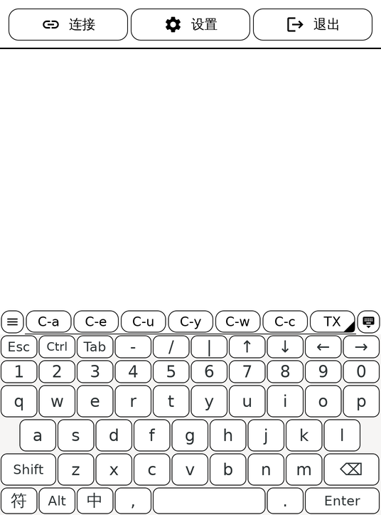

# kterm for Kindle

越狱 Kindle 上的终端，触屏好用。基于 [kterm](https://github.com/bfabiszewski/kterm)，在 Kindle Paperwhite 4 上日常使用。

<p>


</p>

## 能做什么

- **适合敲命令的键盘**：Esc、Ctrl、Tab、方向键和数字都在第一屏。Shift 出大写和 `!@#`，“符”键出 F1–F12 和各种符号。按下的 Shift、Ctrl、Alt、“符”会变黑，用完自动恢复。
- **中文输入**：点“中”调出 Kindle 自带的拼音键盘。
- **快捷栏**：键盘上方一排按钮，点一下发一串按键，比如 `C-a`、`C-u`、tmux 前缀。可以在面板里添加、修改、删除；按钮多了左右滑动翻页。
- **上滑面板**：在键盘上往上滑打开，点键盘或终端就收起。
  - **连接**：保存 SSH 服务器，点一下就连上；正在连着别的也能直接切过去。
  - **快捷键**：管理快捷栏。
  - **设置**：字号，改了会记住。
  - **阅读**：收起键盘专心看输出，上下滑动翻屏；在 tmux 里左右滑动切窗口。
  - **旋转**：横屏 / 竖屏。
  - **退出**
- **一键安装**：KPM 安装包，装完图书馆里多一个“终端”。

## 安装

需要：已越狱的 Kindle，装好 [KPM](https://hackerdude.tech) 和 Alpine 镜像（`/mnt/us/alpine`）。

1. 从 [Releases](../../releases) 下载 `kterm-vte_<版本>_kindlehf.kpkg`，拷到 Kindle 根目录。
2. 在 Kindle 上执行：`kpm -y install file:///mnt/us/kterm-vte_<版本>_kindlehf.kpkg`
   第一次会在 Alpine 里装 GTK+ 3 和 VTE（约 60 MB），需要联网。
3. 在图书馆里打开“终端”。

---

## 技术说明

### 和原版的区别

- 在 Kindle 的 X 服务器上跑 GTK+ 3 和 VTE 0.84（来自 Alpine 的软件包，程序在 Alpine chroot 里运行）。
- 窗口用 X 服务器的 8 位 TrueColor 格式，和屏幕同深度，不用转换。32 位窗口每次刷新都要由 X 服务器转换成灰度，在 Kindle 深色模式下慢约 50 倍，持续输出会让整台设备卡死。代价是灰度只有 8 级，界面颜色按这 8 级挑选（`KTERM_VISUAL=32` 可换回 32 位窗口）。
- 新键盘布局 [layouts/keyboard-kindle.xml](layouts/keyboard-kindle.xml)：每行 10 个键宽，Shift / “符”两层；键宽从屏幕宽度算（直接问 X 服务器，旋转后立即正确）。
- 触屏手势：Kindle 触屏驱动在滑动中途会多发一次右键，这里不当成按键。上滑开面板、下滑收面板，阅读模式下滑动翻屏。
- 拼音输入：通过 lipc / D-Bus 调起系统键盘，把它输入的文字转给终端（[ime.c](ime.c)）。
- 面板（[panel.c](panel.c)）：SSH 连接直接存在 `~/.ssh/config` 的 Host 块里（[sshconf.c](sshconf.c)），只改动对应的那几行，所以命令行、scp、git 也能用同一份配置。
- 快捷栏（[shortbar.c](shortbar.c)、[shortpage.c](shortpage.c)）：按钮存在 `shortcuts.conf`；按键写法由 [keyseq.c](keyseq.c) 解析，表单里会实时用中文说明这串按键会做什么。
- 字号保存到 `kterm.conf`（[confedit.c](confedit.c)，只替换那一行，保留注释）。

### 配置文件（设备上，Alpine 里）

| 文件 | 内容 |
|---|---|
| `/usr/local/etc/kterm/kterm.conf` | 字号、tmux 前缀（`tmux_prefix`，阅读模式切窗口用）等 |
| `/usr/local/etc/kterm/shortcuts.conf` | 快捷栏按钮，写法见文件里的注释 |
| `~/.ssh/config` | 保存的 SSH 连接 |

`shortcuts.conf` 一行一个按钮，`#` 开头的行是注释：

```
# 按钮显示 C-u，发 Ctrl+u
C-u
# 按钮显示 TX，发 Ctrl+Space（tmux 前缀）
TX = C-Space
# 引号里是文字，Enter 是回车
拉代码 = "git pull" Enter
```

### 构建和打包

需要 Docker（用 Alpine armv7 镜像交叉编译）、`rsvg-convert`、Python 3。

```sh
sh kindle/build.sh      # 编译，输出 build/kterm
sh kindle/package.sh    # 打包，输出 build/kterm-vte_<版本>_kindlehf.kpkg（含完整源码，GPL）
```

- `kindle/kpm/`：安装包内容（manifest、安装 / 卸载 / 启动脚本、图标）。
- `kindle/uitest.sh`：不用 Kindle，在 Docker 里的虚拟 X 屏幕上运行界面，可以点击、滑动、截图。
- `kindle/shot.sh`：通过 SSH 抓 Kindle 屏幕截图（`KINDLE=root@<地址>`）。
- `tests/`：按键写法、快捷栏文件、配置改写、SSH 配置的单元测试（只依赖 GLib），例如：
  `cc $(pkg-config --cflags --libs glib-2.0) -I. tests/test_keyseq.c keyseq.c -o /tmp/t && /tmp/t`

---

## 原版 kterm 说明（upstream）

This is a simple GTK+ terminal emulator with embedded virtual keyboard. It is based on VteTerminal library. Some initial settings may be defined in [kterm.conf](kterm.conf) file. Keyboard layouts are defined in [xml config](layouts/keyboard.xml) files. The keyboard config files follow the same rules as matchbox keyboard configs (backward compatible with kterm 1.x which used embedded matchbox keyboard).

Kterm has been developed for Kindle Touch. It is reported to also work on Paperwhites. Generally it should work on any platform which supports GTK+, either version 2 or 3.

On Kindle menu pops up on two fingers tap in the terminal window. On other devices on right button mouse click.

#### Keyboard [XML config](layouts/keyboard.xml) **\<nodes\>** and **attributes**:
  * **\<layout\>** - layout
  * **\<row\>** - row
  * **\<space\>** - empty spacer
  * **\<key\>** - key, attributes:
    * **extended** = [true|false], *optional*, if true only visible in landscape mode, defaults to false;
    * **fill** = [true|false], *optional*, if true button will expand to use all available space, defaults to false;
    * **width** = [width in kterm units], *optional*, 1000 is standard width, 2000 will be double width key and so on; defaults to 1000;
    * **obey-caps** = [true|false], *optional*, should button change on caps lock press, defaults to false;
  * **\<default\>** - default variant (no modifier)
  * **\<shifted\>** - shifted variant (shift/caps lock modifier pressed)
  * **\<mod1\>** - mod1 variant (mod1 modifier pressed)
  * **\<mod2\>** - mod2 variant (mod2 modifier pressed)
  * **\<mod3\>** - mod3 variant (mod3 modifier pressed)
    * attributes for all variant nodes (default, shifted, …):
    * **display** = [character|image\:/path/to/image], *required*, character to display or image path (absolute must start with slash, otherwise relative to config);
    * **action** = [character|special name|modifier\:name], *required for keys with image label, modifiers, special buttons*, character sent to terminal, name of special action, or name of modifier, defaults to *display* attribute value;
    * for a list of special key names see [this lookup table](https://github.com/bfabiszewski/kterm/blob/master/parse_layout.c#L41); valid modifier keys are: shift, caps, ctrl, alt, mod1, mod2, mod3
 
 
#### Command line options:
```
$ ./kterm -h
Usage: kterm [OPTIONS]
        -c <0|1>      color scheme (0 light, 1 dark)
        -d            debug mode
        -e <command>  execute command in kterm
        -E <var>      set environment variable
        -f <family>   font family
        -h            show this message
        -k <0|1>      keyboard off/on
        -l <path>     keyboard layout config path
        -o <U|R|L>    screen orientation (up, right, left)
        -s <size>     font size
        -t <encoding> terminal encoding
        -u <B|I|U>    cursor shape (block, I-beam, underline)
        -v            print version and exit
```

For a list of what constitutes valid encodings, check [this list][iana-character-sets] or the list returned by `iconv -l`.

#### Screenshots
![kterm reversed color scheme][screenshot1] 
![kterm hidden keyboard][screenshot2]
![kterm landscape mode][screenshot3]

#### Changelog
  * **2.6**: option for setting cursor shape (by efskap)
  * **2.5**: option for setting terminal encoding (by deuill)
  * **2.4**: fix: some special keys won't work, add path to terminfo in Kindle start script
  * **2.3**: fix: issue with uneven keyboard rows height, unresponsivness when popup menu is cancelled, autotools build and other minor bugs
  * **2.2**: fix launching kterm with hidden keyboard; add config/command line option for screen rotation (screen orientation will also be restored to initial value after quitting kterm); fix flickering at start; remove unneeded files from kindle package, add high resolution key images; some other minor issues
  * **2.1**: mainly small bugfixes, compilation warnings
  * **2.0**: major rewrite; added native keyboard which replaces matchbox keyboard - better stability, easier to compile and maintain; updated to build on modern frameworks; added autotools project; option to rotate screen on Kindle; option to add environment variables on command line
  * **0.7**: keyboard layout for Paperwhite (by nasser), also larger labels for Touch keyboard
  * **0.6**: parameter for choosing different keyboard layout from config and command line; new keyboard layout for Touch and Paperwhite (by cubemike99 and DuckieTigger)
  * **0.5**: support for mouse events (for ncurses apps etc)
  * **0.4**: added command line options(see kterm -h), fixed colors
  * **0.3**: xterm-like "-e" option support (by Fvek), simple config file added, removed bug with blocked key-up event when quiting with exit command (traced by aditya3098)
  * **0.2**: patch for matchbox-keyboard to get rid of absolute paths in config file
  * **0.1**: first release

#### Building
* dependencies: [GTK+](https://github.com/GNOME/gtk) version 2 or 3 (use `--enable-gtk3`), [VTE](https://github.com/GNOME/vte), optionally [dbus](https://www.freedesktop.org/wiki/Software/dbus/) for Kindle screen rotation
* `$ ./autogen.sh`
* `$ ./configure`
* `$ make`
* `$ sudo make install`
* for Kindle build use `--enable-kindle --sysconfdir=/mnt/us/extensions/kterm` configure options. If you are cross-compiling run `make dist-kindle` instead of `make install`. It will create zip package in build directory.

#### Packages 
* for Kindle Touch/Paperwhite are available at http://www.fabiszewski.net/kindle-terminal/

#### License
 * GPL version 3 or (at your option) any later version

[screenshot1]:http://www.fabiszewski.net/kindle-terminal/screenshot_v2_1.png "kterm screenshot"
[screenshot2]:http://www.fabiszewski.net/kindle-terminal/screenshot_v2_2.png "kterm screenshot"
[screenshot3]:http://www.fabiszewski.net/kindle-terminal/screenshot_v2_3.png "kterm screenshot"
[iana-character-sets]: https://www.iana.org/assignments/character-sets/character-sets.txt
